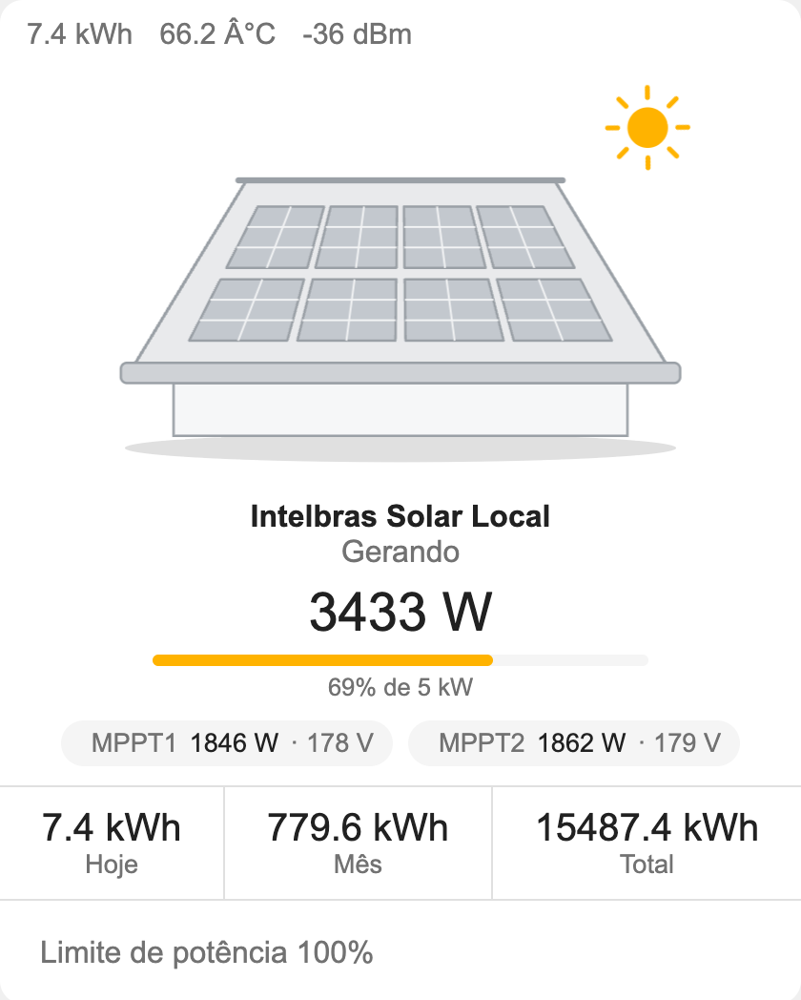

# Intelbras Solar Card

[](https://hacs.xyz)
[](https://github.com/hudsonbrendon/intelbras-solar-card/releases)
[](https://github.com/hudsonbrendon/intelbras-solar-card/actions/workflows/lint.yml)


Lovelace card for Intelbras inverters (EGT / IONS — Sungrow WiNet-S inside)
running the [Intelbras Solar Local integration](https://github.com/hudsonbrendon/ha-intelbras-solar-local).
Same layout as the vacuum card — tips row, animated illustration, name +
status, stats and a toolbar — but for a solar plant:

- **Minimal drawn illustration** in the same grey / white style as the HP
  printer and vacuum cards: a roof with a 2×4 PV array. While producing the
  sun turns and a shine sweeps the panels (faster with more power); the sun
  greys out on standby, moon and stars at night (`sun.sun`), a warning sign
  over the ridge on fault, greyed out when the inverter is offline. Respects
  `prefers-reduced-motion` and dark mode.
- **Tips**: energy today, inverter temperature, datalogger Wi-Fi and active
  alarms.
- **Power** in large type with a load bar (`% of nominal kW`) and one pill per
  MPPT string (power · voltage).
- **Stats** per state (today / month / total by day; today / peak / total at
  night), configurable.
- **Toolbar**: power-limit toggle (with confirmation) and set-point, sync the
  inverter clock, restart the datalogger (with confirmation); fault code when
  in fault; your own shortcuts. The inverter on/off switch is intentionally
  not exposed.



## Installation

1. HACS → Frontend → ⋮ → *Custom repositories* → add
   `https://github.com/hudsonbrendon/intelbras-solar-card` as *Dashboard*.
2. Install **Intelbras Solar Card**. HACS adds the resource automatically.

Manual: copy `dist/intelbras-solar-card.js` to `config/www/` and add
`/local/intelbras-solar-card.js` as a JavaScript module resource.

## Configuration

The card finds every entity of the integration (inverter, datalogger and plant
devices) from the entity registry, so the minimal config is just the inverter
device:

```yaml
type: custom:intelbras-solar-card
device: f095df…   # device id of the inverter (pick it in the visual editor)
```

| Option | Default | Description |
| --- | --- | --- |
| `device` | — | Device registry id of the inverter. |
| `entities` | — | Explicit overrides per key (`work_state`, `ac_power`, `energy_today`...). Without `device`, `entities.work_state` is required. |
| `name` | device name | Title shown under the illustration. |
| `show_name` / `show_status` / `show_strings` / `show_toolbar` | `true` | Toggle sections. |
| `compact_view` | `false` | Hide the illustration, strings and stats. |
| `language` | HA language | Force `en` or `pt-BR`. |
| `stats` | see below | Per-state list (`default`, `producing`, `night`, ...) of `{ key \| entity, attribute, unit, subtitle }`. |
| `shortcuts` | `[]` | Extra toolbar buttons `{ name, icon, service, service_data, target }` or `{ key }` (button press). |

Keys: `work_state`, `ac_power`, `dc_power`, `nominal_power`, `energy_today`,
`energy_month`, `energy_year`, `energy_total`, `temperature`, `efficiency`,
`grid_voltage`, `grid_frequency`, `mppt1_power`, `mppt1_voltage`,
`mppt2_power`, `mppt2_voltage`, `running_time_today`, `active_alarms`,
`fault_code`, `peak_power_today`, `specific_yield_today`, `savings_today`,
`co2_avoided`, `trees_saved`, `installed_capacity`, `wifi_signal`... Subtitles
starting with `stat.` are translated.

```yaml
type: custom:intelbras-solar-card
device: f095df…
stats:
  producing:
    - key: energy_today
      subtitle: stat.energy_today
    - key: efficiency
      subtitle: stat.efficiency
    - key: temperature
      subtitle: stat.temperature
```

## Development

```bash
npm install
npm run build      # dist/intelbras-solar-card.js
npm test           # vitest
npm run lint && npm run typecheck
```

## License

MIT
